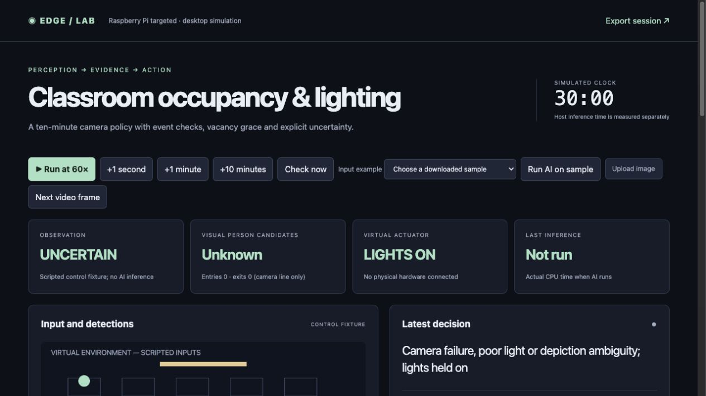

# Smart classroom occupancy and lighting

A camera candidate count drives a conservative lighting state machine. Motion and door events request new checks; absence of motion never establishes vacancy. The default recheck interval is 600 seconds, with a 120-second grace period and two negative observations before switch-off. Tracking provides line-crossing counts only when camera geometry supports that interpretation.

**Raspberry Pi targeted · desktop simulation tested · AI-assisted personal project.** Physical deployment is pending.



## Run locally

```sh
python3.12 -m venv .venv
.venv/bin/python -m pip install -r requirements.txt
.venv/bin/python app.py
# Open http://127.0.0.1:8811
```

Control scenarios run without pretrained models. For real inference, complete [model setup and demonstration](docs/setup-and-demo.md). The source archive excludes pretrained backbones and COCO photographs; a trained waste head is included where applicable.

## Measured comparison

| Metric | Baseline | Final | Scope |
|---|---:|---:|---|
| Person detection F1 (score) | 0.632 | 0.736 | 78 COCO test images; IoU >= 0.5; threshold 0.25; 320 to 640 pixels |
| Count mean absolute error (people/image) | 1.128 | 0.603 | Same 78 images; visual labels, not verified physical presence |
| Occupied with lights off (simulated seconds) | 1200.000 | 0.000 | 3600-second scripted trace; default 600-second interval |
| Estimated lighting energy (Wh) | 40.000 | 120.000 | Assumed 120 W load; synthetic trace; no measured power |

Higher resolution increased F1 from 0.632 to 0.736 but lowered precision from 0.867 to 0.829 and increased detector median host latency from 13.31 to 48.50 ms. The combined policy kept lights on throughout the difficult one-hour scripted trace: occupied-off time fell from 1200 to 0 seconds, while assumed energy rose from 40 to 120 Wh. This experiment does not demonstrate energy savings.

Nine of ten synthetic framed-photo composites still produced person candidates. The target for lighting is a physically present person, but COCO labels and the pretrained detector represent visual people; they do not establish liveness. Configured depiction zones mark ambiguity, and cannot discover every poster or screen. Tracking can also track a poster. No real classroom poster, seated-person, bags, crowd or screen-specific accuracy was measured. Image splits lack recording IDs; crowd annotations are excluded under a documented nonstandard metric.

## Evidence and documentation

- [Technical report PDF](docs/technical-report.pdf) and [editable Word report](docs/technical-report.docx)
- [Architecture](docs/architecture.png) and [state transition source](docs/state-machine.mmd)
- [Hardware interfaces and wiring plan](docs/hardware.md)
- [Dataset and model card](docs/model-and-data.md)
- [Dashboard panel guide](docs/dashboard-guide.md)
- [Code walkthrough, ten interview questions and exercises](docs/mentor-guide.md)
- [Version and failure history](docs/FAILURES.md)
- [Raw results](evidence/results.json), [comparison CSV](evidence/metrics.csv), and [test log](evidence/tests.txt)

## Validation scope

Raspberry Pi targeted, desktop simulation tested. No Pi, real sensor, electrical power, camera timing, motor or physical safety validation was performed. This is an AI-assisted personal engineering project; it does not establish professional seniority or independent authorship.

56 shared regression cases passed. Real inference and browser scenarios were checked separately. The benchmark and application clocks are separate: inference time is measured on the host; control traces use explicit simulation time. No production adoption, physical safety certification, Pi latency or measured energy is claimed.

Project contact: Abhijith Viswanathan · abhijithviswanathan03@gmail.com. Intended GitHub owner: abhijith-abhii. Repository publication requires that account's write access; no remote repository is claimed by this package.

## Generated stress input and additional graphs

[Explore the AI-generated image, actual model output and diagnostic graph](docs/generated-tests.md). The synthetic scene is available in the dashboard sample menu and is excluded from the held-out benchmark.
