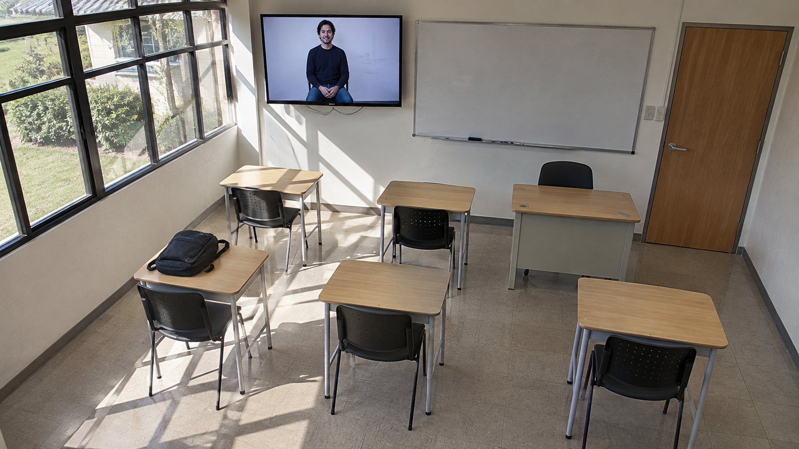
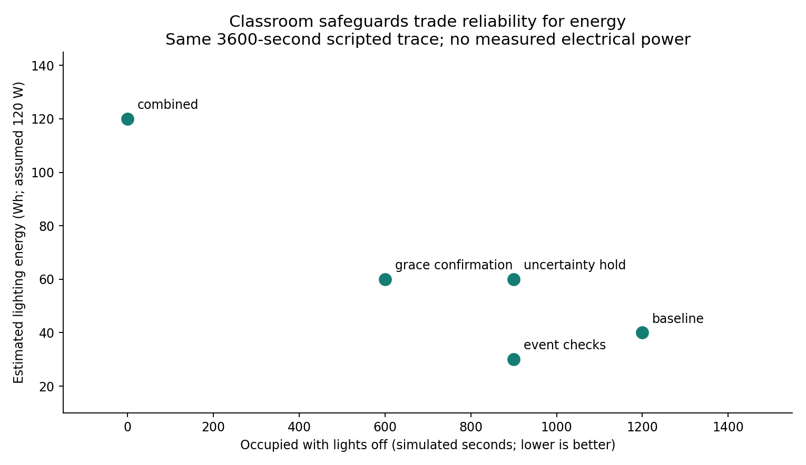

# Generated test image and diagnostic graphs

Human-reviewed synthetic scene: no physically present person; one person depicted on a TV; empty chairs, a bag and shadows. Prompt count of six chairs is approximate, not an annotation.

Detected candidates: person=1, chair=5, screen=1. Person candidates are visual depictions here; unconfigured detector output does not prove room occupancy.

Exploratory generated input, n=1 per project, no statistical accuracy claim, no training or threshold tuning, excluded from headline held-out benchmarks.

Generated using the built-in image tool. Full prompt and SHA256 are retained in samples/generated-test-provenance.json. Select the generated stress scene in the local dashboard to run actual inference again. It is separate from real COCO and TrashNet test images.

## Prompt

Use case: photorealistic-natural. Asset type: synthetic computer vision test input for a classroom occupancy prototype. Generate one realistic landscape photograph from a fixed upper corner camera of an EMPTY small classroom, with six empty chairs and desks, one backpack on a desk, strong diagonal window shadows, and a wall-mounted television visibly showing a life-size photograph of a seated adult person. No physically present people. Make the TV frame unambiguous and the depicted person's full torso visible. Natural ordinary room, no logos, no bounding boxes, no infographic, no captions. This is deliberately synthetic evaluation material, not claimed real footage.

## Diagnostic graph

The graph below uses preserved evaluation results, not invented results for the generated scene.
